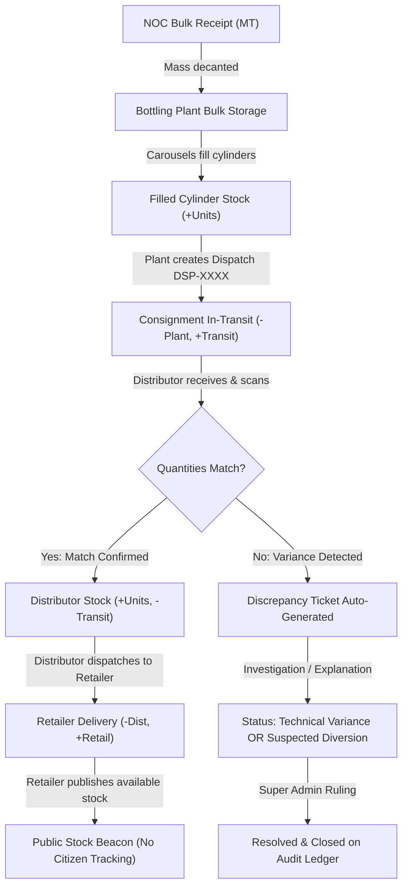
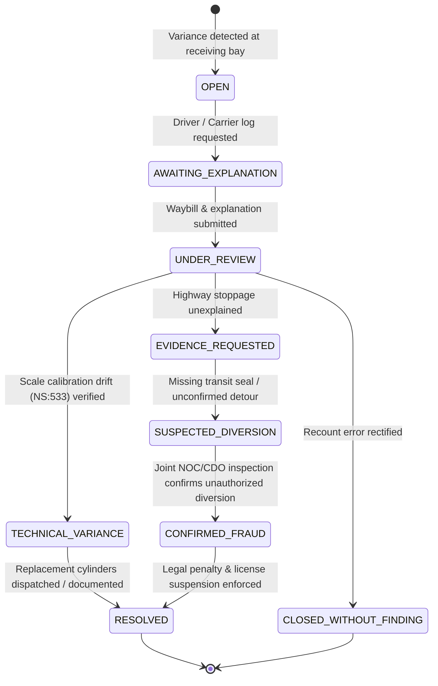

# Entity-Relationship Architecture — LPG Tracker Nepal

**Document Ref:** `docs/entity-relationships.md`  
**Standard:** Mermaid Entity-Relationship & Flowchart Models  
**Domain:** National LPG Custody Transfer & Physical Double-Entry Ledger

---

## 1. Domain Entity Relationship Diagram

```mermaid
erDiagram
    ORGANIZATIONS ||--o{ USERS : "employs"
    ORGANIZATIONS ||--o{ LOCATIONS : "operates"
    ORGANIZATIONS ||--o{ ORGANIZATION_DOCUMENTS : "submits"
    ORGANIZATIONS ||--o{ ORGANIZATION_APPROVALS : "receives"
    ORGANIZATIONS ||--o{ BULK_RECEIPTS : "decants"
    ORGANIZATIONS ||--o{ FILLING_BATCHES : "produces"
    ORGANIZATIONS ||--o{ DISPATCHES : "sends / receives"
    ORGANIZATIONS ||--o{ RECEIPT_CONFIRMATIONS : "confirms"
    ORGANIZATIONS ||--o{ DISCREPANCY_CASES : "involved_in"
    ORGANIZATIONS ||--o{ PUBLIC_AVAILABILITY : "broadcasts"

    USERS ||--o{ ORGANIZATION_MEMBERSHIPS : "belongs_to"
    ORGANIZATIONS ||--o{ ORGANIZATION_MEMBERSHIPS : "has_members"
    USERS ||--o{ AUDIT_LOGS : "acts_in"
    USERS ||--o{ COMPLAINTS : "files"
    USERS ||--o{ NOTIFICATIONS : "receives"

    LOCATIONS ||--o{ STOCK_BALANCES : "holds"
    LOCATIONS ||--o{ STOCK_MOVEMENTS : "records_movement"
    LOCATIONS ||--o{ STOCK_ADJUSTMENTS : "adjusts"

    CYLINDER_CATEGORIES ||--o{ FILLING_BATCHES : "categorizes"
    CYLINDER_CATEGORIES ||--o{ DISPATCH_ITEMS : "specifies"
    CYLINDER_CATEGORIES ||--o{ RECEIPT_CONFIRMATION_ITEMS : "verifies"
    CYLINDER_CATEGORIES ||--o{ STOCK_BALANCES : "measures"
    CYLINDER_CATEGORIES ||--o{ PUBLIC_AVAILABILITY : "publishes"

    DISPATCHES ||--|{ DISPATCH_ITEMS : "contains"
    DISPATCHES ||--o| RECEIPT_CONFIRMATIONS : "acknowledged_by"
    DISPATCHES ||--o| DISCREPANCY_CASES : "triggers_if_mismatch"

    RECEIPT_CONFIRMATIONS ||--|{ RECEIPT_CONFIRMATION_ITEMS : "details"
    DISCREPANCY_CASES ||--o{ DISCREPANCY_EVIDENCE : "includes"
    DISCREPANCY_CASES ||--o{ DISCREPANCY_COMMENTS : "investigates"

    COMPLAINTS ||--o{ COMPLAINT_UPDATES : "tracks_progress"
```

---

## 2. Custody Transfer & Double-Entry Stock Movement Flow

---

## 3. Discrepancy Case State Transition Machine

